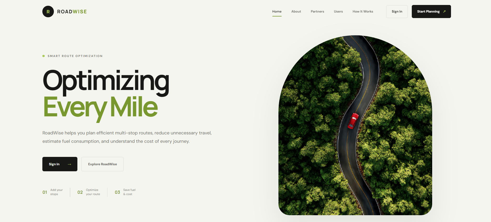
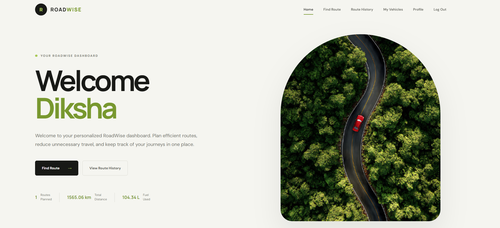
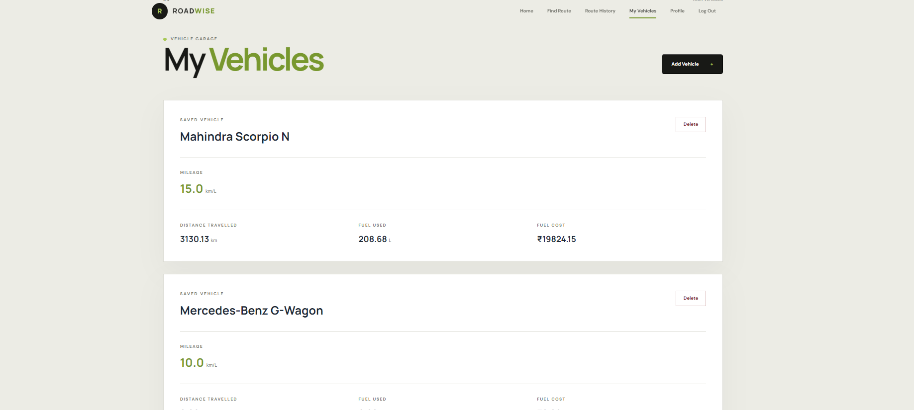
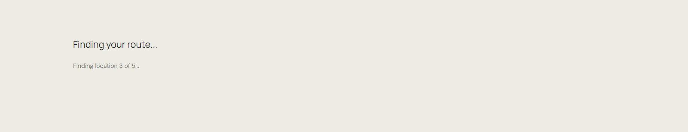
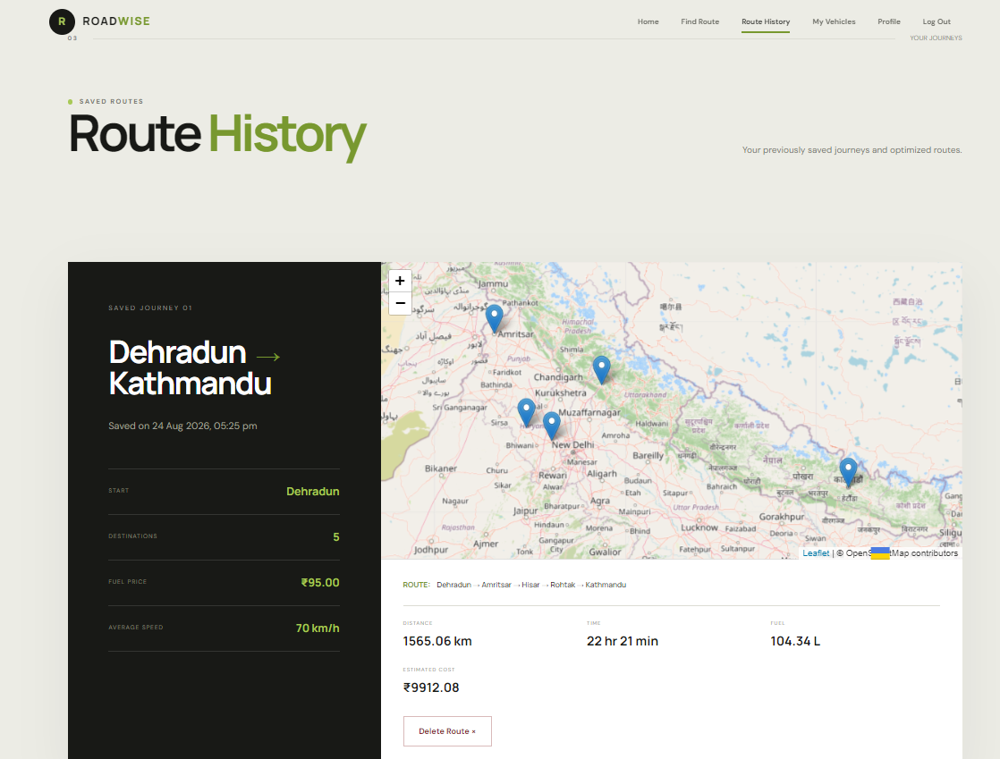

# 🚗 ROADWISE — Optimizing Every Mile

**Smart Routes • Fuel Efficiency • Cost Optimization**

ROADWISE is a route-planning and travel-cost optimization project designed to help users plan journeys, manage vehicles, estimate fuel consumption, and understand expected travel expenses.

**Live Demo:** [ROADWISE on Vercel](https://roadwise-six.vercel.app/)

## ✨ Key Features

- **Smart Route Planning:** Plan journeys between locations and explore efficient routes.
- **Vehicle-Aware Optimization:** Use vehicle details when estimating journey efficiency.
- **Fuel Consumption Estimation:** Estimate the fuel required for a journey.
- **Fuel Cost Calculation:** Understand expected fuel expenses before travelling.
- **Journey Insights:** Review route, fuel usage, distance, and estimated cost information.
- **Route History:** Revisit previously planned journeys.
- **My Vehicles:** Add and manage vehicles using details such as vehicle type, fuel type, and mileage.
- **Personalized Dashboard:** Access saved vehicles, recent journeys, route history, and travel insights.
- **Responsive Interface:** Use the application across different screen sizes.
- **Backend APIs:** A Node.js and Express backend provides API routes for authentication, vehicles, journeys, and petrol-pump-related functionality.

## 🛠️ Technology Stack

### Frontend
- HTML5
- CSS3
- JavaScript
- Leaflet for map integration
- OpenStreetMap and location-search services

### Backend
- Node.js
- Express.js
- MongoDB
- Mongoose
- JSON Web Token (JWT) for authentication
- bcryptjs for password hashing
- dotenv for environment configuration
- CORS for cross-origin requests

### Development and Deployment
- Git and GitHub
- VS Code
- Nodemon for backend development
- Vercel for the frontend demo

## 📸 Product Showcase

The screenshots below illustrate the ROADWISE user interface. Images are stored inside `FrontEnd/Assets/Images/`.

### 1. Landing Experience



### 2. Personalized Dashboard



### 3. My Vehicles



### 4. Route Planning




### 5. Vehicle Selection


### 6. Optimization Results


### 7. Route History



## 📁 Project Structure

```text
ROADWISE-OptimizingEveryMile/
├── Backend/
│   ├── config/
│   ├── controllers/
│   ├── middleware/
│   ├── models/
│   ├── routes/
│   ├── .env                  # Local secrets; do not commit
│   ├── package.json
│   ├── package-lock.json
│   └── server.js
├── FrontEnd/
│   ├── Assets/
│   │   └── Images/
│   ├── CSS/
│   ├── JS/
│   ├── Pages/
│   └── index.html
├── .gitignore
└── README.md
```

## 🚀 Getting Started

### Prerequisites

Install the following before running the project:

- [Node.js and npm](https://nodejs.org/)
- A MongoDB database, such as MongoDB Atlas
- Git
- A modern web browser

### 1. Clone the Repository

```bash
git clone https://github.com/jaismeen-sidhubrar/ROADWISE-OptimizingEveryMile.git
cd ROADWISE-OptimizingEveryMile
```

### 2. Configure the Backend

Open a terminal in the repository root and navigate to the backend:

```bash
cd Backend
npm install
```

Create a `.env` file inside the `Backend/` directory. Add your own configuration values:

```env
PORT=5000
MONGO_URI=your_mongodb_connection_string
JWT_SECRET=your_long_random_secret
FRONTEND_URL=http://127.0.0.1:5500
```

Replace the example values with your actual configuration. Never commit real database credentials, tokens, or secrets to GitHub.

`FRONTEND_URL` should contain the origin used by your frontend. If you use a different local development address or a deployed frontend, configure the corresponding origin. If multiple origins are needed, use comma-separated values supported by the backend.

### 3. Start the Backend

For development with automatic restarts:

```bash
npm run dev
```

Or start the server normally:

```bash
npm start
```

The backend uses port `5000` by default unless `PORT` is configured differently.

You can check the health endpoint at:

```text
http://localhost:5000/api/health
```

A successful health response should return:

```json
{
  "ok": true
}
```

The health endpoint checks that the server is responding; it does not by itself confirm that every API or database operation is working.

### 4. Run the Frontend

Open a separate terminal at the repository root and start a local static server for the `FrontEnd/` directory.

For example, if you use the VS Code Live Server extension, open `FrontEnd/index.html` and select **Open with Live Server**.

Make sure the frontend's API requests point to the backend address being used in your environment. If the frontend uses a different API configuration, update it to match your setup.

## 🔌 Backend API Overview

The backend registers the following route groups:

| Route prefix | Purpose |
|---|---|
| `/api/health` | Server health check |
| `/api/auth` | Authentication |
| `/api/vehicles` | Vehicle-related operations |
| `/api/other-vehicles` | Additional vehicle operations |
| `/api/routes` | Route-related operations |
| `/api/petrol-pumps` | Petrol-pump-related operations |

These are route prefixes. The exact endpoints, supported HTTP methods, required request bodies, and response formats depend on the individual route handlers.

You can test API requests using [Postman](https://www.postman.com/) or [Thunder Client](https://www.thunderclient.com/).

## 🌱 Our Vision

> Make every journey smarter, more efficient, and more economical.

ROADWISE connects route planning with vehicle information and estimated travel costs to help users make more informed travel decisions.

Because optimizing a journey isn't only about getting there.

**It's about optimizing every mile.**

## 👥 Team

Developed with passion for smarter and more sustainable mobility.

**ROADWISE — Optimizing Every Mile**

## 📄 License

This project is developed for educational and project purposes. Refer to the repository for applicable licensing information.
