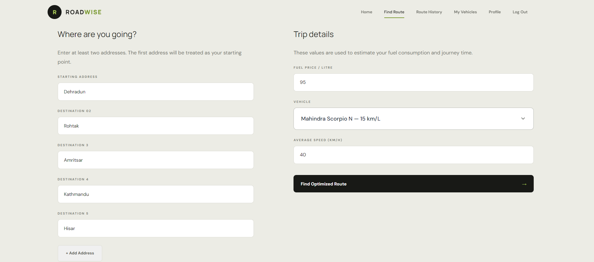
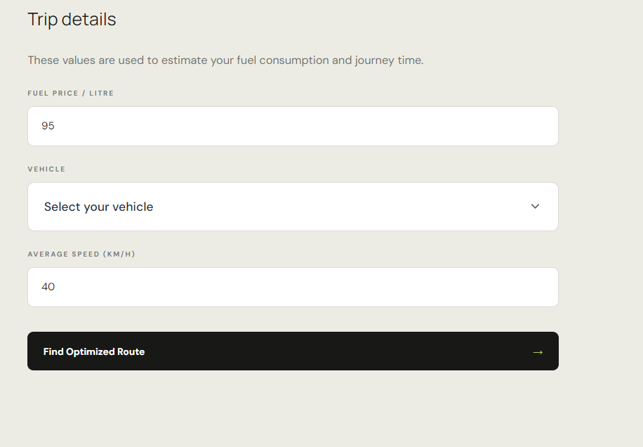
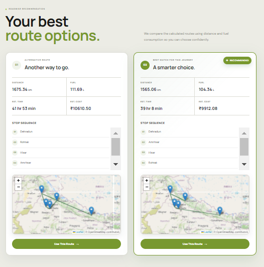

# 🚗 ROADWISE

### Optimizing Every Mile

<p align="center">
  <strong>Smart Routes • Fuel Efficiency • Cost Optimization</strong>
</p>

<p align="center">
  <a href="https://roadwise-six.vercel.app/">🌐 Live Demo</a>
  &nbsp;&nbsp;•&nbsp;&nbsp;
  <a href="https://github.com/jaismeen-sidhubrar/ROADWISE-OptimizingEveryMile">💻 GitHub</a>
</p>

---

## 🌱 Drive Smarter. Spend Less.

**ROADWISE** is a vehicle route and fuel cost optimization platform designed to help users make smarter travel decisions.

Instead of simply finding a route from one location to another, ROADWISE focuses on the bigger picture — **distance, vehicle efficiency, fuel consumption, and overall travel cost**.

> **Every journey has a cost. ROADWISE helps you optimize it.**

---

## 🎯 Why ROADWISE?

Traditional route planning primarily focuses on reaching the destination.

But an efficient journey is about more than distance.

* 🚗 Different vehicles have different fuel efficiencies.
* ⛽ Longer routes can significantly increase fuel consumption.
* 💰 Fuel expenses can become a major part of travel costs.
* 🗺️ Choosing the right route can make every journey more economical.

**ROADWISE brings these factors together to make route planning more practical and cost-conscious.**

---

## ✨ Key Features

### 🗺️ Smart Route Planning

Plan journeys between locations and explore efficient travel routes.

### 🚗 Vehicle-Aware Optimization

Take the selected vehicle into consideration when estimating journey efficiency.

### ⛽ Fuel Consumption Estimation

Estimate the fuel required for a journey based on distance and vehicle efficiency.

### 💰 Fuel Cost Calculation

Understand the expected fuel expense before starting your journey.

### 📊 Journey Insights

Get meaningful information about your route, fuel usage, and estimated travel cost.

### 🕘 Route History
Keep track of previously planned journeys and revisit route, distance, fuel, and cost information.

### 🚘 My Vehicles
Add and manage personal vehicles with details such as vehicle type, fuel type, and mileage for more personalized calculations.

### 📱 Responsive Interface

Designed to provide a clean and accessible experience across different screen sizes.

---

## 🚘 Personalized Travel

ROADWISE is designed around your actual vehicles and journeys.

## 📊 Personalized Dashboard

Your ROADWISE dashboard brings your travel information together in one place.

Users can quickly access:

- 🚗 **My Vehicles** — View and manage saved vehicles
- 🕘 **Route History** — Revisit previous journeys
- ⛽ **Fuel Insights** — Track estimated fuel consumption
- 💰 **Travel Costs** — Monitor journey expenses
- 📍 **Recent Journeys** — Quickly access recently planned routes

> **One dashboard. Every journey. Smarter decisions.**

### 🕘 Route History

View previously planned routes and their journey details in one place.

Users can revisit:
- 📍 Previous routes
- 📏 Journey distance
- ⛽ Fuel consumption
- 💰 Estimated travel cost

### 🚗 My Vehicles

Add your own vehicles and use their information when planning journeys.

You can manage details such as:
- Vehicle name
- Vehicle type
- Fuel type
- Mileage / fuel efficiency

This allows ROADWISE to provide more personalized fuel and cost estimates.

### 📊 Personalized Dashboard
A personalized overview of your journeys, saved vehicles, route history, fuel usage, and travel costs — all in one place.

## ⚙️ How ROADWISE Works

```text
       📍 ENTER JOURNEY
              │
              ▼
       🚗 SELECT VEHICLE
              │
              ▼
       🗺️ PLAN YOUR ROUTE
              │
              ▼
       📏 CALCULATE DISTANCE
              │
              ▼
       ⛽ ESTIMATE FUEL
              │
              ▼
       💰 CALCULATE COST
              │
              ▼
       📊 VIEW RESULTS
              │
       ┌──────┼──────┐
       ▼      ▼      ▼
  🕘 HISTORY 🚘 VEHICLES 📊 DASHBOARD
```

---

# 📸 Product Showcase

## 01 — Landing Experience

<p align="center">
  
</p>

> A clean starting point for planning a smarter journey.

---

## 02 — Personalized Dashboard

<p align="center">
  
</p>

> Your journeys, vehicles, fuel insights, and travel costs — organized in one personalized dashboard.

---

## 03 — My Vehicles

<p align="center">
  
</p>

> Add and manage your vehicles to personalize fuel and cost calculations.

---


## 04 — Route Planning

<p align="center">
  
</p>

<p align="center">
  
</p>

> Enter your journey details and plan your route efficiently.

---

## 05 — Vehicle Selection

<p align="center">
  
</p>

> Select the vehicle to make fuel and cost calculations more relevant to the journey.

---

## 06 — Optimization Results

<p align="center">
  
</p>

> View the journey information, estimated fuel consumption, and travel cost.

---

## 07 — Route History
<p align="center">
  
</p>

> Keep track of previous journeys and revisit important route and cost information.

---


# 🛠️ Technology Stack

<p align="center">

**Frontend**

`HTML5` • `CSS3` • `JavaScript`

**Deployment**

`Vercel`

</p>

---

# 📁 Project Structure

```text
ROADWISE-OptimizingEveryMile/
│
├── Assets/
│   └── Images/
│
├── CSS/
        index.css
        my-vehicle.css
        profile.css
        route_planner.css
        route-history.css
│
├── JS/
        dashboard.js
        index.js
        my-vehicle.js
        navbar.js
        profile.js
        route_history.js
        route-planner.js
│
├── Pages/
        dashboard.html
        my-vehicle.html
        navbar.html
        profile.html
        route_history.html
        route-planner.html
│
├── index.html
│
└── README.md
```

---

# 🚀 Getting Started

## 1. Clone the Repository

```bash
git clone https://github.com/jaismeen-sidhubrar/ROADWISE-OptimizingEveryMile.git
```

## 2. Navigate to the Project

```bash
cd ROADWISE-OptimizingEveryMile
```

## 3. Run the Project

Open `index.html` in your browser.

For the best development experience, use **VS Code with Live Server** or another local development server.

---

# 🌐 Live Demo

Experience ROADWISE directly:

<p align="center">

### 🚗 [Launch ROADWISE](https://roadwise-six.vercel.app/)

</p>

---

# 🔮 Future Scope

ROADWISE can be extended into a more comprehensive intelligent mobility platform.

### 🚦 Real-Time Traffic

Integrate live traffic information to improve route recommendations.

### ⛽ Dynamic Fuel Prices

Use current fuel prices to provide more accurate cost estimates.

### ⚡ Electric Vehicle Support

Extend the platform to include EV range and charging requirements.

### 🧠 Advanced Route Optimization

Introduce additional parameters such as traffic, tolls, road conditions, and travel time.

### 📊 Journey History

Allow users to save previous journeys and analyze their travel patterns.

### 👤 Personalized Recommendations

Provide recommendations based on individual driving habits and vehicle usage.

---

# 🌍 Our Vision

> **Make every journey smarter, more efficient, and more economical.**

ROADWISE aims to move beyond traditional navigation by connecting **route planning with real-world travel costs**.

Because optimizing a journey isn't only about getting there.

**It's about optimizing every mile.**

---

# 👩‍💻 Team

Developed with passion for smarter and more sustainable mobility.

**ROADWISE — Optimizing Every Mile**

---

## 📄 License

This project is developed for educational and project purposes.

---

<p align="center">
  <strong>🚗 ROADWISE</strong>
  <br>
  <sub>Optimizing Every Mile</sub>
</p>
